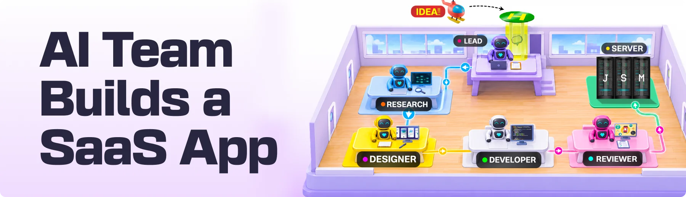
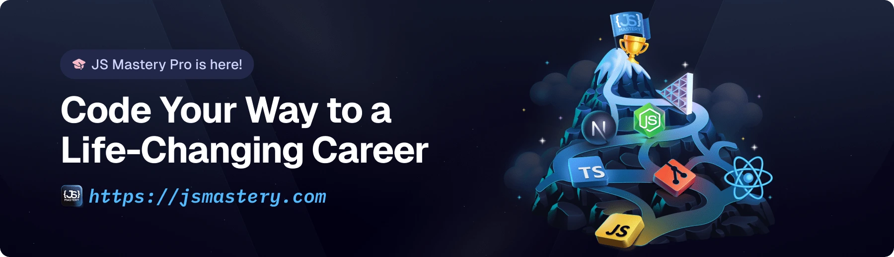

<div align="center">
  <br />
    <a href="https://youtu.be/Nq8uOOMH9fg" target="_blank">
      
    </a>
  <br />

  <div>


<br/>


  </div>

  <h3 align="center">AskWell | AI Chatbot Trained on Your Docs</h3>

   <div align="center">
     Build this project step by step with our detailed tutorial on <a href="https://www.youtube.com/watch?v=XUkNR-JfHwo" target="_blank"><b>JavaScript Mastery</b></a> YouTube. Join the JSM family!
    </div>
</div>

## 📋 <a name="table">Table of Contents</a>

1. ✨ [Introduction](#introduction)
2. ⚙️ [Tech Stack](#tech-stack)
3. 🔋 [Features](#features)
4. 🤸 [Quick Start](#quick-start)
5. 🔗 [Assets](#links)
6. 🚀 [More](#more)

## 🚨 Tutorial

This repository contains the code corresponding to an in-depth tutorial available on our YouTube channel, <a href="https://www.youtube.com/@javascriptmastery/videos" target="_blank"><b>JavaScript Mastery</b></a>.

If you prefer visual learning, this is the perfect resource for you. Follow our tutorial to learn how to build projects like these step-by-step in a beginner-friendly manner!

<a href="https://youtu.be/Nq8uOOMH9fg" target="_blank"></a>

## <a name="introduction">✨ Introduction</a>

AskWell is a SaaS that gives any business an AI chatbot for its website. A business signs up, creates a project, and uploads its docs, such as a product guide, a pricing page, or an FAQ. It then pastes a single script tag into its site, and a chat bubble appears that answers visitors using only those docs. When the answer isn't in the docs, the bot says so instead of making something up. Every conversation lands in the owner's dashboard, and on the Pro plan owners can restyle the widget and remove the AskWell badge.

Because the chatbot is public and every answer costs money, AskWell is built with abuse protection on the chat endpoint and per-answer cost tracking from day one, so owners can offer a fast, always-on assistant without worrying about runaway usage.

If you're getting started and need assistance or face any bugs, join our active Discord community with over **50k+** members. It's a place where people help each other out.

<a href="https://discord.com/invite/n6EdbFJ" target="_blank"></a>

## <a name="tech-stack">⚙️ Tech Stack</a>

- **[Supabase](https://jsm.dev/jsmhq-supabase)** is an open-source backend platform built on Postgres that provides a database, storage, and APIs out of the box. In AskWell, it stores projects, uploaded knowledge, and conversations, with separate development and production projects to keep live data isolated.

- **[Clerk](https://jsm.dev/jsmhq-clerk)** is an authentication and user management platform with drop-in components for sign-in, sign-up, and profiles. AskWell uses it for business owner accounts and for the paid Pro plan that unlocks widget customization.

- **[Arcjet](https://jsm.dev/jsmhq-arcjet)** is a developer-first security layer that adds protections like rate limiting and bot detection directly in application code. It guards AskWell's public chat endpoint, so anyone on the internet can talk to the bot without running up costs through abuse.

- **[PostHog](https://jsm.dev/jsmhq-posthog)** is an open-source product analytics platform for tracking events, usage, and user behavior. In AskWell, it powers conversation analytics and shows exactly what each AI answer costs.

- **[CodeRabbit](https://jsm.dev/jsmhq-coderabbit)** is an AI code review tool that automatically reviews pull requests and leaves line-by-line feedback. Every pull request to AskWell is reviewed by CodeRabbit before it's merged into main.

- **[Vercel](https://vercel.com/)** is a cloud platform for deploying and hosting web applications with automatic preview deployments. It builds a preview of every pull request during development and hosts AskWell in production.

## <a name="features">🔋 Features</a>

👉 **Project Workspaces**: Business owners sign up and create a separate project for each website they want to support.

👉 **Knowledge Uploads**: Upload docs like product guides, pricing pages, and FAQs, and see each one marked ready once it's processed.

👉 **One-Line Embed**: Copy a single script tag into any website to add a floating chat bubble.

👉 **Grounded AI Answers**: The chatbot answers visitors only from the uploaded docs and says it doesn't know when the answer isn't there.

👉 **Conversations Dashboard**: Every visitor chat is saved and viewable in the owner's dashboard.

👉 **Answer Cost Analytics**: Track usage and see what each AI answer costs.

👉 **Pro Plan Billing**: Upgrade from Free to Pro to unlock paid features.

👉 **Widget Customization**: Pro users can change the widget's colors and remove the AskWell badge, with changes showing up live on their site.

👉 **Public Endpoint Protection**: Rate limiting and bot protection keep the open chat from being abused.

And many more, including code architecture and reusability.

## <a name="quick-start">🤸 Quick Start</a>

Follow these steps to set up the project locally on your machine.

**Prerequisites**

Make sure you have the following installed on your machine:

- [Git](https://git-scm.com/)
- [Node.js](https://nodejs.org/en)
- [npm](https://www.npmjs.com/) (Node Package Manager)

**Cloning the Repository**

```bash
git clone https://github.com/jsmastery-pro/askwell.git
cd askwell
```

**Installation**

Install the project dependencies using npm:

```bash
npm install
```

**Set Up Environment Variables**

Create a new file named `.env` in the root of your project and add the following content:

```env
# Supabase
NEXT_PUBLIC_SUPABASE_URL=
NEXT_PUBLIC_SUPABASE_PUBLISHABLE_KEY=
SUPABASE_SECRET_KEY=

# Supabase Storage (S3-compatible)
AWS_ENDPOINT_URL_S3=
AWS_REGION=
AWS_ACCESS_KEY_ID=
AWS_SECRET_ACCESS_KEY=
BUCKET_NAME=

# Clerk
NEXT_PUBLIC_CLERK_PUBLISHABLE_KEY=
CLERK_SECRET_KEY=
CLERK_WEBHOOK_SIGNING_SECRET=

# OpenAI
OPENAI_API_KEY=

# PostHog
NEXT_PUBLIC_POSTHOG_KEY=
NEXT_PUBLIC_POSTHOG_HOST=https://us.i.posthog.com
POSTHOG_API_KEY=
POSTHOG_HOST=https://us.i.posthog.com

# Arcjet
ARCJET_KEY=
ARCJET_ENV=development

# Vercel
VERCEL_AUTOMATION_BYPASS_SECRET=

# App
NEXT_PUBLIC_APP_URL=
```

Replace the placeholder values with your real credentials. You can get these by signing up at: [**Supabase**](https://jsm.dev/jsmhq-supabase), [**Clerk**](https://jsm.dev/jsmhq-clerk), [**Arcjet**](https://jsm.dev/jsmhq-arcjet), and [**PostHog**](https://jsm.dev/jsmhq-posthog).

**Running the Project**

```bash
npm run dev
```

Open [http://localhost:3000](http://localhost:3000) in your browser to view the project.

## <a name="links">🔗 Assets</a>

Assets and snippets used in the project can be found in the **[video kit](https://jsm.dev/jsmhq-kit)**.

<a href="https://jsm.dev/jsmhq-kit" target="_blank">
  
</a>

## <a name="more">🚀 More</a>

**Advance your skills with our Pro Course**

Enjoyed creating this project? Dive deeper into our PRO courses for a richer learning adventure. They're packed with
detailed explanations, cool features, and exercises to boost your skills. Give it a go!

<a href="https://jsm.dev/jsmhq-engineer" target="_blank">
  
</a>